  <picture><source media="(prefers-color-scheme: dark)" srcset="./cards/hero-dark.svg" /></picture>

  
  
  

  <a href="https://github.com/mateto2/SAVETT"><picture><source media="(prefers-color-scheme: dark)" srcset="./cards/repo-savett-dark.svg" /></picture></a>
  <a href="https://github.com/mateto2/bi-inflacao-brasil"><picture><source media="(prefers-color-scheme: dark)" srcset="./cards/repo-bi-dark.svg" /></picture></a>

  <picture><source media="(prefers-color-scheme: dark)" srcset="./cards/tech-dark.svg" /></picture>

  <picture><source media="(prefers-color-scheme: dark)" srcset="./cards/streak-dark.svg" /></picture>

  <picture><source media="(prefers-color-scheme: dark)" srcset="./cards/snake-dark.svg" /></picture>

  <picture><source media="(prefers-color-scheme: dark)" srcset="./cards/activity-dark.svg" /></picture>

