  

  

  

  
  
  

  
  

  

  <a href="mailto:ferreiraamaralmatheus@gmail.com">Gmail</a> ·
  <a href="https://www.linkedin.com/in/matheusamaralf/">LinkedIn</a> ·
  <a href="https://github.com/mateto2?tab=repositories">Todos os projetos</a>

